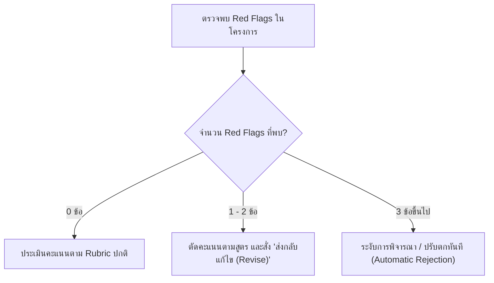

# ตารางเกณฑ์การหักคะแนนสัญญาณอันตรายเชิงพฤติกรรม (Behavioral Red Flags Deduction Rubric)
**บทบาทผู้ประเมิน:** Senior Moral & Behavioral Evaluation Specialist  
**วัตถุประสงค์:** ใช้คัดกรอง ตรวจจับ และหักคะแนนข้อเสนอโครงการที่มีความเสี่ยงสูงที่จะล้มเหลวในการปรับเปลี่ยนพฤติกรรมมนุษย์

---

## 1. ตารางเกณฑ์การหักคะแนน Red Flags 10 ประการ (The 10 Behavioral Red Flags Rubric)

| รหัส | ชื่อสัญญาณอันตราย (Red Flag) | พฤติการณ์ที่ตรวจพบในข้อเสนอโครงการ (Observed Symptoms) | เหตุผลทางพฤติกรรมศาสตร์ว่าทำไมจึงล้มเหลว (Behavioral Rationale) | มิติ/เสาหลักที่ได้รับผลกระทบ | อัตราการหักคะแนน (Penalty Formula) | เงื่อนไขการยกเว้น/ข้อแก้ไขที่ยอมรับได้ (Mitigation) |
| :---: | :--- | :--- | :--- | :--- | :---: | :--- |
| **RF-01** | **Activity & Training Trap** *(กับดักจัดอบรม/สัมมนาเชิงอีเวนต์)* | งบประมาณ $\ge 60\%$ หมดไปกับค่าอาหารว่าง ค่าเช่าสถานที่ ค่าวิทยากร และของแจก โดยไม่มีแผนติดตามพฤติกรรมหลังการอบรม | **Knowledge-Action Gap:** การรับรู้ความรู้เปลี่ยนพฤติกรรมจริงได้ไม่ถึง 10% หากขาดการปรับสิ่งแวดล้อมและแรงจูงใจต่อเนื่อง | เสาหลักที่ 2 (Nudge) และ เสาหลักที่ 4 (ความยั่งยืน) | **หักคะแนนเสาหลักที่ 2 และ 4 ลง 60%** ทันที | มีกระบวนการประกบรายบุคคลหลังอบรม $\ge 3$ เดือน และมีงบติดตามผล $\ge 30\%$ |
| **RF-02** | **Zero Baseline** *(ไร้ข้อมูลสถิติฐานเดิม / อ้างปัญหาลอยๆ)* | ระบุปัญหาแบบกว้างๆ เช่น "ชาวบ้านขาดวินัย" หรือ "ขยะล้นชุมชน" แต่ไม่มีตัวเลขสถิติ ผลสำรวจ หรือปริมาณเดิมก่อนเริ่มโครงการ | **Unanchored Metrics:** ไม่สามารถพิสูจน์ผลสัมฤทธิ์ได้ว่าพฤติกรรมเปลี่ยนจริงหรือเป็นเพียงความบังเอิญ/ความรู้สึก | เสาหลักที่ 1 (Target Behavior & Baseline) | **หักคะแนนเสาหลักที่ 1 เหลือไม่เกิน 1 คะแนน** (จาก 5) | มีการออกแบบแบบสำรวจ Baseline ชัดเจนในสัปดาห์แรกก่อนเริ่มกิจกรรม |
| **RF-03** | **Sentiment-Only KPI** *(วัดแค่ความพึงพอใจและรอยยิ้ม)* | ตัวชี้วัดความสำเร็จมีเพียง "ผู้เข้าร่วมพึงพอใจร้อยละ 90" หรือ "ผู้เข้าอบรมมีความรู้เพิ่มขึ้น" โดยไม่มีตัวชี้วัดพฤติกรรมจริงในชีวิตประจำวัน | **Kirkpatrick Level 1 Illusion:** ความพึงพอใจในวิทยากรหรืออาหารว่าง ไม่ได้สะท้อนการเปลี่ยนนิสัยถาวรในชีวิตจริง | เสาหลักที่ 4 (Behavioral Outcomes) | **หักคะแนนเสาหลักที่ 4 เหลือไม่เกิน 1 คะแนน** (จาก 5) | เพิ่มตัวชี้วัดพฤติกรรมเชิงประจักษ์ (Level 3) เช่น สถิติขยะลดลง หรือเงินออมเพิ่มขึ้น |
| **RF-04** | **Hostile Choice Architecture** *(สั่งสอนให้ทำดี แต่สิ่งแวดล้อมไม่เอื้อ)* | รณรงค์ให้คนทำความดี แต่สภาพแวดล้อมทางกายภาพมีแรงเสียดทานสูง เช่น สั่งให้แยกขยะแต่ไม่มีถังแยก, สั่งให้ออมเงินแต่ไม่มีจุดรับฝากในชุมชน | **Friction Friction Trap:** มนุษย์จะเลือกทำสิ่งที่สะดวกที่สุดเสมอ หากทำดีแล้วยุ่งยาก พฤติกรรมใหม่จะถูกยกเลิกทันที | เสาหลักที่ 2 (Choice Architecture & Nudge) | **หักคะแนนเสาหลักที่ 2 เหลือไม่เกิน 1 คะแนน** (จาก 5) | มีการจัดสรรงบประมาณปรับปรุงกายภาพและอุปกรณ์อำนวยความสะดวกชัดเจน |
| **RF-05** | **Toothless Charter** *(ธรรมนูญกระดาษ / ไร้สภาพบังคับทางสังคม)* | เขียนข้อตกลงหรือธรรมนูญชุมชนสวยหรู แต่ไม่มีกลไกกำกับดูแล ไม่มีคณะกรรมการตรวจเยี่ยมคุ้มบ้าน และไม่มีมาตรการทางสังคมรองรับ | **Tragedy of Social Loafing:** เมื่อไม่มีใครจับตาดูหรือตักเตือน คนจะละเมิดกติกาตามความคุ้นเคยเดิมจนกติกาไร้ค่า | เสาหลักที่ 3 (Community Charter & Norms) | **หักคะแนนเสาหลักที่ 3 ลง 50%** | มีกลไกคณะกรรมการคุ้มบ้านตรวจเยี่ยมจริง พร้อมมาตรการยกย่องและตักเตือน |
| **RF-06** | **Absent Leadership** *(ผู้นำตัดริบบิ้น / ผู้นำไม่ทำเป็นแบบอย่าง)* | ผู้นำองค์กร/ชุมชนเพียงแค่มากล่าวเปิดงานและถ่ายรูป ไม่ได้ประกาศเจตนารมณ์หรือร่วมเปลี่ยนพฤติกรรม หรือมีพฤติกรรมขัดแย้งกับโครงการ | **Hypocrisy & Low Self-Efficacy:** การเรียนรู้ทางสังคม (Bandura) ต้องอาศัยผู้นำเป็นตัวแบบ หากผู้นำไม่ทำ ประชาชนจะไม่ทำตาม | เสาหลักที่ 2 (Role Models & Mentorship) | **หักคะแนนเสาหลักที่ 2 ลง 40%** | ผู้นำลงชื่อร่วมเป็นผู้ปฏิบัติตามกติกาและเปิดเผยพฤติกรรมตนเองต่อสาธารณะ |
| **RF-07** | **Single Champion Dependency** *(วิกฤตพึ่งพาบุคคลคนเดียว)* | โครงการผูกติดกับผู้นำเพียงคนเดียว ไม่มีโครงสร้างคณะกรรมการ บวร หรือทีมงานสืบทอดรุ่นใหม่ | **Structural Fragility:** หากผู้นำย้าย เกษียณ หรือหมดวาระ โครงการและพฤติกรรมใหม่จะพังทลายทันที | เสาหลักที่ 3 (Governance) และ เสาหลักที่ 4 (ความยั่งยืน) | **หักคะแนนเสาหลักที่ 3 และ 4 ลง 40%** | จัดตั้งคณะทำงาน 3 วัย (เยาวชน-วัยทำงาน-ผู้สูงอายุ) และมีกลไกสืบทอดชัดเจน |
| **RF-08** | **Budget Exhaustion Death** *(โครงการตายพร้อมงบประมาณ)* | กิจกรรมทั้งหมดพึ่งพางบประมาณจากผู้ให้ทุนภายนอก 100% ไม่มีแผนตั้งกองทุนหมุนเวียน หรือไม่มีการผลักดันเข้าแผนพัฒนา อปท. | **Extrinsic Dependency:** เมื่อแรงกระตุ้นทางการเงินจากภายนอกหมดลง พฤติกรรมจะหยุดชะงักทันที | เสาหลักที่ 4 (Sustainability & System) | **ปรับคะแนนความยั่งยืนเป็น 0 คะแนน** ทันที | มีการผูกโยงเข้าเทศบัญญัติ อปท. หรือตั้งกองทุนสวัสดิการชุมชนเลี้ยงตัวเองได้ |
| **RF-09** | **Top-down Alienation** *(โครงการลอกการบ้าน / สั่งการจากบนลงล่าง)* | ลอกรูปแบบโครงการจากพื้นที่อื่นมาใช้โดยไม่ปรับให้เข้ากับทุนทางสังคม วัฒนธรรม หรือบริบท คนในพื้นที่รู้สึกเป็นเพียง "ผู้ถูกกระทำ" | **Lack of Psychological Ownership:** คนจะไม่ปกป้องและไม่ยินดีปฏิบัติตามกติกาที่ตนเองไม่ได้มีส่วนร่วมสร้าง | เสาหลักที่ 3 (Bottom-up Ownership) | **หักคะแนนเสาหลักที่ 3 ลง 50%** | มีบันทึกเวทีประชาคมที่ชุมชนร่วมถกเถียงและปรับเปลี่ยนเนื้อหาโครงการเอง |
| **RF-10** | **Perverse Incentives** *(แจกของเพื่อซื้อพฤติกรรม / แรงจูงใจผิดเพี้ยน)* | ใช้วิธีแจกเงินสด แจกบัตรกำนัลราคาแพง หรือแจกสิ่งของมีค่าเพื่อให้คนมาร่วมทำความดี | **Crowding-out Effect:** ทำลายแรงจูงใจภายใน (Intrinsic Motivation) คนจะทำความดีเฉพาะตอนมีของแจกเท่านั้น | เสาหลักที่ 2 (Incentives & Recognition) | **หักคะแนนเสาหลักที่ 2 ลง 50%** | ปรับเปลี่ยนเป็นระบบ Recognition เกียรติยศ หรือเชื่อมโยงสวัสดิการส่วนรวม |

---

## 2. เมทริกซ์การรวมผลกระทบจาก Red Flags ต่อการตัดสินโครงการ

AI ผู้ประเมินจะต้องนำจำนวน Red Flags ที่ตรวจพบ มาเป็นเกณฑ์ชี้ขาดในการตัดสินผล (Veto / Override Rule):

| ระดับความรุนแรงของ Red Flags | จำนวน Red Flags ที่ตรวจพบ | ผลกระทบต่อผลการตัดสิน (Verdict Override) | แนวทางการจัดการของผู้ประเมิน |
| :---: | :---: | :---: | :--- |
| **ระดับวิกฤต (Critical Risk)** | **$\ge 3$ ข้อ** | **ปรับตกทันที (Automatic Rejection)** *ไม่ว่าคะแนนรวมคำนวณจะได้เท่าใด* | ตีตราโครงการเป็น "โครงการเชิงอีเวนต์ที่ไม่คุ้มค่าต่องบประมาณ" ปฏิเสธการจัดสรรทุน |
| **ระดับเตือนภัยสูง (High Risk)** | **2 ข้อ** | **ชะลอการอนุมัติ (Hold & Revise)** *เพดานคะแนนรวมไม่เกิน 69 คะแนน* | บังคับให้ผู้เสนอโครงการแก้ไขเงื่อนไขจุดตายทั้ง 2 ข้อ ก่อนนำกลับมาพิจารณาใหม่ |
| **ระดับเตือนภัยปานกลาง (Moderate Risk)** | **1 ข้อ** | **ตัดคะแนนตามเกณฑ์ (Conditional Pass)** | ตัดคะแนนเฉพาะเสาหลักที่ได้รับผลกระทบ หากคะแนนรวมยังผ่านเกณฑ์ ให้แนบเงื่อนไขบังคับก่อนเบิกจ่าย |
| **ระดับมาตรฐาน (Clean Proposal)** | **0 ข้อ** | **พิจารณาตามคะแนน Rubric ปกติ** | โครงการมีความพร้อมเชิงพฤติกรรมสูง เข้าสู่การพิจารณาระดับต้นแบบ (Level 3-4) |
